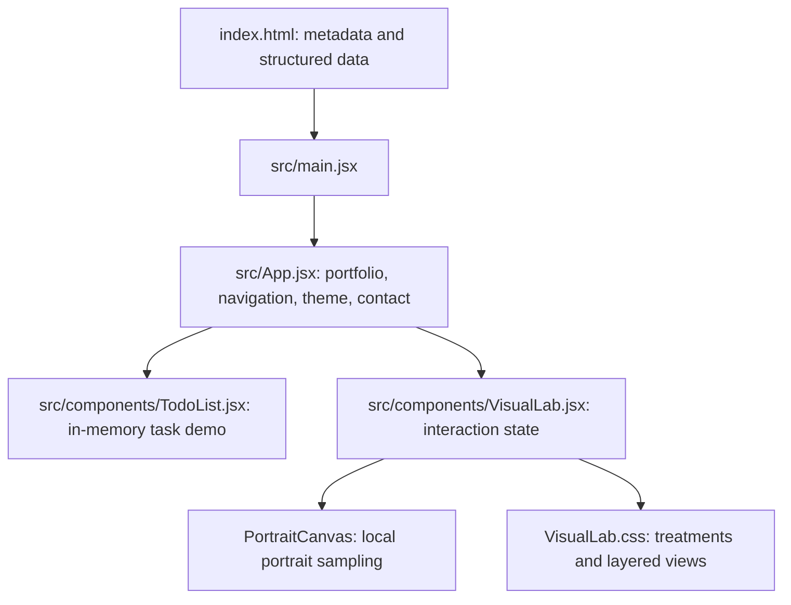

# Architecture

Vite 8 builds a React 19 single-page application. No application server, database, authentication, or API keys are required. `src/main.jsx` mounts `App` in StrictMode.

## State and rendering
Theme is saved locally when storage is available. Task data remains in memory. Lab state tracks treatment, view, layer depth, rotation and pause. Framer Motion uses LazyMotion with a separately loaded domAnimation feature bundle. Canvas samples the local portrait into points and computes ordered dithering with a 4×4 Bayer matrix. Pointer events request frames; no perpetual idle render loop runs. IntersectionObserver gates particle displacement and cleanup removes observers/listeners/frames on unmount. Reduced-motion changes are observed at runtime.

Layered views use CSS perspective and transforms around a flat image. The 360° control rotates the image plane; it does not reveal new sides of a 3D subject. The datamosh treatment emulates a glitch aesthetic, not video codec corruption.

## Deployment
Vercel serves `dist` after `npm run build`. `public/robots.txt`, `public/sitemap.xml` and `public/social-preview.jpg` are copied into the output. `vercel.json` defines browser security headers for deployment; Vite preview does not apply them. Metadata lives in index.html and must stay aligned with the public domain.

## Trust boundaries
Email content is URI-encoded and passed to the visitor’s email application. No HTML injection or user-data persistence is used by the form. DM Sans and Space Grotesk are self-hosted from Fontsource; no external font service is required. Never put credentials into Vite variables: client bundles are public.
